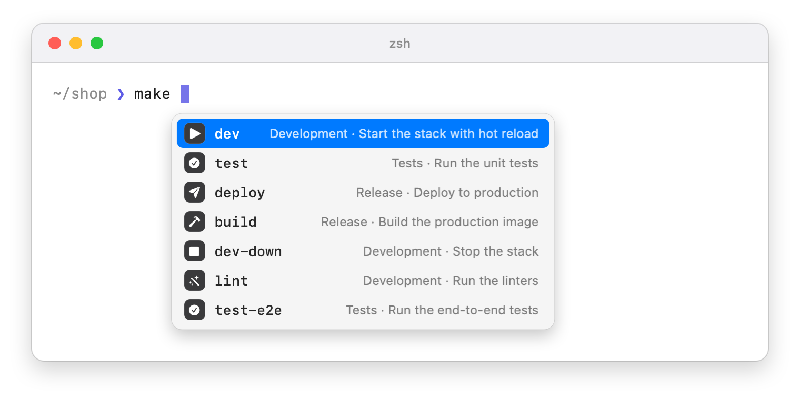

# Figxit

IDE autocomplete for your terminal on macOS. As you type in zsh, bash, or fish, Figxit lists subcommands, options, files, Makefile targets, and `package.json` scripts, ranked by what you use in the current project.

Free and open source. No account, no AI chat, no telemetry.

<picture>
  <source media="(prefers-color-scheme: dark)" srcset="assets/make-dark.png">
  
</picture>

## Why it exists

Fig put autocomplete in the terminal: type `git ` and see every subcommand with a short description. Fig joined AWS in 2023 and shut down in September 2024. Its autocomplete moved to Amazon Q Developer CLI, then to Kiro CLI, and [Kiro CLI 3.0](https://kiro.dev/changelog/cli/3-0/) removed it in November 2026 with no replacement.

Figxit is a direct replacement for that autocomplete on macOS: a native app, open source, and maintained.

The open alternatives each miss a part:

- Shell completion opens only when you press Tab, and does not know what you use most.
- Tools that draw the list inside the terminal have to wrap your shell.
- History search finds past commands, but does not show what a command can do.

Figxit does all three: the list opens as you type, it knows 700+ tools, and your history sets the order.

## What it does

### Subcommands and options

Figxit uses the open source Fig specs for 700+ tools. Type a command and a space for its subcommands, or a dash for its options.

<picture>
  <source media="(prefers-color-scheme: dark)" srcset="assets/git-dark.png">
  
</picture>

Specs also fill in live values: git branches after `git checkout `, hosts after `ssh `, files and folders where a command takes a path. Your git and gh aliases work too: `git co ` completes like `git checkout `.

### Makefile targets and scripts

`make ` lists the targets in the current folder, with their help text. `npm run `, `pnpm `, `yarn `, and `bun run ` list the scripts in `package.json`, with the command each one runs. See [Conventions](#conventions) for the help text and the icons.

<picture>
  <source media="(prefers-color-scheme: dark)" srcset="assets/scripts-dark.png">
  
</picture>

### Ranking from your history

With [Atuin](https://atuin.sh) installed, Figxit reads your history (read-only). Words you used in this folder, in this repository, or recently come first. Without Atuin, the list still works.

### zoxide

`z rack` lists the folders zoxide matches, in the order `z` would jump.

## Conventions

Figxit follows conventions many projects already use. All of them are optional.

### Makefile help text

```make
##@ Development
dev: ## Start the stack with hot reload
test: ## Run the unit tests

##@ Release
release: ## [prod] Publish the app
```

| You write | Figxit shows |
|---|---|
| `##@ Development` | A section name in front of the targets below it |
| `dev: ## Start the stack` | "Start the stack" as the description of `dev` |
| `release: ## [prod] Publish the app` | A red icon on `release`. The tag itself is hidden |

The tags are `[prod]`, `[production]`, `[danger]`, and `[caution]`, at the start of the help text.

### Red icon for production

A row gets a red icon when:

| Rule | Examples |
|---|---|
| The name is in capitals | SSH host `PROD`, target `DEPLOY` |
| The name has the word `prod` or `production` | `deploy:prod`, `api-prod`, `prod-db-1` |
| A Makefile target has a tag in its help text | `release: ## [prod] Publish the app` |

It applies to Makefile targets, `package.json` scripts, and live values like SSH hosts and Docker contexts. It does not apply to files, subcommands, options, or your history. Enter inserts a red row without running it.

### Icons from the name

A verb in a target or script name picks the icon: `dev`, `start`, and `serve` get play, `test` a check, `build` a hammer, `lint` a wand, `db:migrate` a database, and `dev-down` a stop. The list is in `engine/src/verbs.ts`.

## Install

1. Download [Figxit.dmg](https://figxit.com/download/Figxit.dmg), open it, and move Figxit to Applications.
2. Open Figxit. The setup window shows one line for your shell. Click **Add**, or add it yourself:

   ```bash
   # zsh, in ~/.zshrc
   eval "$('/Applications/Figxit.app/Contents/MacOS/figxit-engine' init zsh)"

   # bash, in ~/.bashrc
   eval "$('/Applications/Figxit.app/Contents/MacOS/figxit-engine' init bash)"

   # fish, in ~/.config/fish/conf.d/figxit.fish
   status is-interactive; and '/Applications/Figxit.app/Contents/MacOS/figxit-engine' init fish | source
   ```

3. Open a new terminal and type a command.

You need an Apple Silicon Mac with macOS 13 or later, and zsh, bash 5, or fish 4. The bash that comes with macOS is 3.2 and too old.

New versions install from the menu bar icon. If something looks off, run `figxit doctor`.

## Keys

| Key | What it does |
|---|---|
| Up, Down | Move through the list |
| Tab | Insert the row |
| Enter | Insert the row and run the line. Turn this off in Settings to only insert |
| Esc | Close the list |

When the list is closed, your keys work as before.

## Works with

Ghostty, iTerm2, and Terminal, and any terminal inside tmux or herdr.

Split panes and the terminal in VS Code or Cursor need Accessibility, which you can allow in Settings. Figxit uses it to find the pane on screen. It does not read the text.

## How it works

Figxit has three parts that talk over local sockets:

```
shell script  ── line and cursor ──▶  engine  ── rows ──▶  app
(zsh, bash, fish)                     (Bun)                (Swift)
      ▲                                  │
      └──────── text to insert ──────────┘
```

- **Shell script** (`shell/`): sends the line to the engine after each key, without waiting. It waits only when you press Tab or Enter with the list open.
- **Engine** (`engine/`): keeps the specs and your history in memory, builds the list, and ranks it. Values that need a command, like git branches, arrive a moment later, so the first rows are never slow.
- **App** (`helper/`): a menu bar app that draws the list under the cursor without taking focus, and restarts the engine if it stops.

Specs maintained by Figxit, for tools Fig does not cover well, live in `engine/src/figxit/`.

## Limits

- macOS only.
- Without Accessibility, the list stays hidden in split panes of the terminal app and in editor terminals.
- The terminal in Zed is not supported. Zed does not report its terminal panel to macOS.
- bash and fish: the list is off in vi mode.
- Outside tmux, the terminal must report its cursor position.
- Values that need a live service, like `kubectl get`, show nothing if the service does not answer in 1.5 seconds.

## Privacy

Figxit runs on your Mac. It reads your shell history and the files in the current folder, and sends neither anywhere.

The only network request is the daily update check, which reads one file from figxit.com. I count those checks and the app downloads by version and date, with no IP address and no identifier. You can turn the check off in Settings.

Words from your history that look like secrets, such as a `--token` value or `API_KEY=...`, are not shown.

## Development

```bash
cd engine && bun install   # once
make dev                   # run the app from source, with reload
make test                  # unit tests
make build                 # build dist/Figxit.app
```

You need [Bun](https://bun.sh) and the Xcode command line tools.

## Credits

Completion specs from [withfig/autocomplete](https://github.com/withfig/autocomplete) (MIT). Tool icons from [Simple Icons](https://simpleicons.org) (CC0), and the logos belong to their owners. Updates by [Sparkle](https://sparkle-project.org) (MIT).

Figxit is not affiliated with Fig, Amazon, or Kiro.

## Licence

MIT. See [LICENSE](LICENSE).
